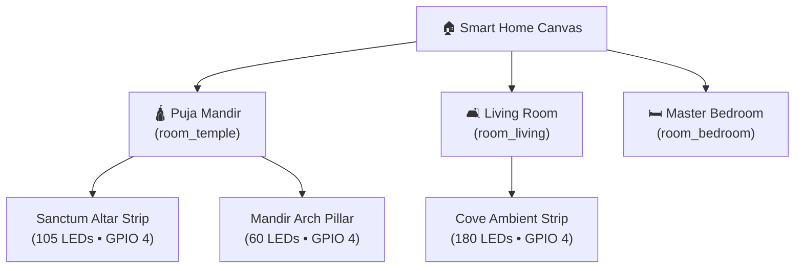

# Temple Lights — Next-Generation Multi-Room, Multi-Segment & Spatial UI/UX Architecture Context

> **Project**: Temple Lights — Smart ESP32 BLE Autonomous WS2812B RGB Controller & Companion Flutter Mobile App  
> **Workspace (Flutter)**: `/Users/hrk/StudioProjects/temple_lights_toggle`  
> **Workspace (Firmware)**: `/Users/hrk/StudioProjects/temple_lights_toggle/firmware`  
> **Firmware Target**: NodeMCU-32S (ESP32-WROOM-32, 4MB Flash, `min_spiffs.csv` dual-OTA)  
> **Hardware Configuration**: Addressable WS2812B Strip on GPIO 4 with Dynamic Software Current Limiting  
> **Design Philosophy**: Apple Home (iOS 18) + Google Home (Material You) + Mushroom/Bubble Card Spatial Hybrid  
> **Current Test Status**: **92/92 Unit/Widget Tests Passing (100% Green)** • **`flutter analyze` 0 Issues** • **Firmware `pio run` SUCCESS**

---

## Table of Contents

1. [Tagged Markdown Files Index](#1-tagged-markdown-files-index)
2. [Executive Summary & Conversation Evolution](#2-executive-summary--conversation-evolution)
3. [Multi-Room & Multi-Device Spatial Architecture](#3-multi-room--multi-device-spatial-architecture)
4. [Arbitrary Multi-Segment LED Control Engine](#4-arbitrary-multi-segment-led-control-engine)
5. [Dynamic Presets (>3 Modes) & Wall-Switch Power-Cycle Carousel](#5-dynamic-presets-3-modes--wall-switch-power-cycle-carousel)
6. [Next-Gen Animation, Shader & Perceptual Dimming Engine](#6-next-gen-animation-shader--perceptual-dimming-engine)
7. [Apple Home & Google Home Hybrid UI/UX Overhaul](#7-apple-home--google-home-hybrid-ui-ux-overhaul)
8. [Continuous Kelvin Warmth Engine (Planckian Blackbody Locus)](#8-continuous-kelvin-warmth-engine-planckian-blackbody-locus)
9. [Tactile Multi-Segment Touch Ruler & Architectural Snap Presets](#9-tactile-multi-segment-touch-ruler--architectural-snap-presets)
10. [Backward Compatibility, Storage Schema & Safe Backup/Restore](#10-backward-compatibility-storage-schema--safe-backuprestore)
11. [ESP32 Firmware Architecture Deep Dive (`firmware/src/main.cpp`)](#11-esp32-firmware-architecture-deep-dive-firmwaresrcmaincpp)
12. [BLE Wire Protocol & Packet Contract Extensions](#12-ble-wire-protocol--packet-contract-extensions)
13. [Verification, Test Suites & Build Audit](#13-verification-test-suites--build-audit)

---

## 1. Tagged Markdown Files Index

The following markdown artifacts and specifications were generated during this architectural session:

| File Reference | Path / Location | Purpose & Substance |
| :--- | :--- | :--- |
| **`architecture_plan.md`** | `~/.gemini/antigravity/brain/3ed37485-209b-49a7-8d1e-a6968df8b6af/architecture_plan.md` | Formal engineering blueprint for multi-segment data structures, dynamic presets, wall-switch carousel flags, Gamma 2.2 tables, and NVS auto-migration (`tl_modes` $\to$ `tl_presets`). |
| **`ui_ux_home_redesign_brainstorm.md`** | `~/.gemini/antigravity/brain/3ed37485-209b-49a7-8d1e-a6968df8b6af/ui_ux_home_redesign_brainstorm.md` | Exhaustive competitive deconstruction of Apple Home (iOS 18), Google Home (Material You), GitHub open-source leaders (Bubble Card, Mushroom Card), and Reddit community feedback (r/WLED, r/HomeKit). |
| **`TEMPLE_LIGHTS_FULL_CONTEXT.md`** | `./TEMPLE_LIGHTS_FULL_CONTEXT.md` | Baseline context document detailing legacy 3-mode operation, dual-OTA flash partitioning, hardware electrical wiring, and BLE GATT protocol fundamentals. |
| **`TEMPLE_LIGHTS_MULTI_ROOM_EXPANSION_CONTEXT.md`** *(This Document)* | `./TEMPLE_LIGHTS_MULTI_ROOM_EXPANSION_CONTEXT.md` | The comprehensive, unified master reference covering all finalised concepts, firmware implementations, Flutter UI components, mathematical formulas, wire contracts, and test verifications. |

---

## 2. Executive Summary & Conversation Evolution

### 2.1 The Problem Statement
The user operates multiple LED light strips across 2–3 physical spaces (e.g., Puja Mandir, Living Room, Master Bedroom). The user posed two fundamental challenges:
1. **Granular LED Customization**: How to control arbitrary, non-contiguous LED segments across the strip (e.g., illuminating only LEDs 1–6 at the start and LEDs 100–105 at the end, while keeping middle LEDs dark or on a different shader).
2. **Dynamic Presets & Animation Customization**: Expanding beyond the fixed 3 legacy modes into arbitrary customizable presets (>3 modes), with independent On/Off transition sweeps, idle glowing shaders (Diya flicker, breathing, starry twinkle, aurora), and wall-switch cycling selection.
3. **Spatial UI/UX Hierarchy**: Transforming the device-centric utility app into an Apple Home / Google Home caliber smart lighting platform that prioritizes rooms, instant glanceability, zero-friction brightness scrubbing, and physical warmth adjustments.
4. **Strict Backward Compatibility**: Guaranteeing that legacy NVS flash schemas (`tl_modes`) and mobile database backups restore seamlessly without app crashes or data loss.

### 2.2 Execution Roadmap
The project proceeded through thorough analysis, rigorous architecture planning, and end-to-end implementation across the mobile app, firmware, and test suites under `/goal`:
* **Phase 1**: Domain models, providers, and wire packet encoders.
* **Phase 2**: ESP32 firmware multi-segment renderer, Gamma 2.2 curve, and NVS migration.
* **Phase 3**: UI/UX spatial hierarchy (Glanceable Status Banner, Sacred Quick Scenes, Room Hero Cards).
* **Phase 4**: Next-gen interaction widgets (Apple/Mushroom Split-Tile cards, Kelvin Warmth slider, Touch Ruler).
* **Phase 5**: Backward-compatible backup engine and comprehensive unit/widget test suites.

---

## 3. Multi-Room & Multi-Device Spatial Architecture

### 3.1 Spatial Room Modeling
Instead of requiring users to hunt for specific Bluetooth MAC addresses or GATT service UUIDs, the application groups devices into physical spaces.



#### The `RoomModel` Schema (`lib/domain/models.dart`)
```dart
class RoomModel {
  const RoomModel({
    required this.id,
    required this.name,
    this.iconName = 'temple',
    this.deviceIds = const [],
  });

  final String id;
  final String name;
  final String iconName;
  final List<String> deviceIds;

  String get iconEmoji {
    switch (iconName.toLowerCase()) {
      case 'temple':
      case 'mandir':
        return '🛕';
      case 'living':
      case 'living_room':
        return '🛋️';
      case 'bed':
      case 'bedroom':
        return '🛏️';
      case 'dining':
        return '🍽️';
      case 'balcony':
        return '🪴';
      default:
        return '🏠';
    }
  }

  static const List<RoomModel> defaultRooms = [
    RoomModel(id: 'room_temple', name: 'Puja Mandir', iconName: 'temple'),
    RoomModel(id: 'room_living', name: 'Living Room', iconName: 'living'),
    RoomModel(id: 'room_bedroom', name: 'Master Bedroom', iconName: 'bedroom'),
  ];
}
```

### 3.2 Whole-Room Synchronization (`RoomsNotifier` in `lib/domain/providers.dart`)
The `RoomsNotifier` manages state across multiple paired devices:
* **`syncRoomPower(String roomId, bool on)`**: Toggles power for all devices assigned to `roomId` (or all rooms if `'all'`), optimistically updates local device cache, and sends BLE command to the currently connected device if located in that room.
* **`syncRoomBrightness(String roomId, int brightness)`**: Pipelined brightness broadcast ensuring all lights in the room dim or brighten simultaneously without visual lag.
* **`syncRoomScene(String roomId, SacredScene scene)`**: Applies coordinated color temperatures, brightness levels, and animation shaders across the entire room.

---

## 4. Arbitrary Multi-Segment LED Control Engine

### 4.1 Concept & User Requirement
A common smart-lighting pain point is treating the entire strip as a uniform monolithic color. The user explicitly requested the ability to partition a strip of $N$ LEDs into discrete zones:
$$\text{e.g., LEDs } 1\dots6 \text{ (Pillars) and LEDs } 100\dots105 \text{ (Crown Halo)}$$

### 4.2 Data Model: `LedSegment`
Defined in [`lib/domain/models.dart`](file:///Users/hrk/StudioProjects/temple_lights_toggle/lib/domain/models.dart):
```dart
class LedSegment {
  const LedSegment({
    required this.start,      // 0-indexed start LED
    required this.count,      // Number of LEDs in segment
    required this.r,
    required this.g,
    required this.b,
    this.brightness = 255,   // Segment brightness multiplier (0..255)
    this.effect = 0,          // 0=Solid, 1=Breathe, 2=Diya, 3=Twinkle, 4=Embers, 5=Aurora, 6=Rainbow
    this.speed = 128,         // Animation frequency
    this.name,                // User label (e.g. 'Front Pillar')
  });

  final int start;
  final int count;
  final int r, g, b;
  final int brightness;
  final int effect;
  final int speed;
  final String? name;

  int get end => (start + count - 1).clamp(start, 65535); // 0-indexed inclusive end LED
  Color get color => Color.fromARGB(255, r, g, b);
  String get displayName => (name != null && name!.trim().isNotEmpty)
      ? name!.trim()
      : 'LEDs #${start + 1}–#${end + 1}';
}
```

### 4.3 Adaptive Software Current Limiting
To prevent voltage drop, strip discoloration, or brownout reboots when driving multiple high-brightness segments on USB/5V power supplies, the firmware computes total estimated milliampere draw dynamically across active segment boundaries:
$$I_{\text{est}} = I_{\text{quiescent}} + \sum_{s \in \text{segments}} \sum_{i=s.\text{start}}^{s.\text{end}} \left( \frac{R_i + G_i + B_i}{3 \times 255} \times 55\,\text{mA} \times \frac{\text{segment\_brightness}}{255} \times \frac{\text{global\_brightness}}{255} \right)$$
If $I_{\text{est}} > I_{\text{max\_ma}}$ (default: 1800 mA), the firmware dynamically scales output intensity:
$$\text{Scale Factor} = \frac{I_{\text{max\_ma}} - I_{\text{quiescent}}}{I_{\text{est}} - I_{\text{quiescent}}}$$

---

## 5. Dynamic Presets (>3 Modes) & Wall-Switch Power-Cycle Carousel

### 5.1 Dynamic Preset Architecture
Legacy versions constrained lighting to 3 hardcoded modes (`m_0`, `m_1`, `m_2`). The platform now supports **up to 16 fully customizable presets** stored in NVS under the `"tl_presets"` namespace.

#### The `LightPreset` Model (`lib/domain/models.dart`)
```dart
class LightPreset {
  const LightPreset({
    required this.index,            // 0..15
    required this.name,             // e.g. 'Morning Aarti'
    required this.brightness,       // 0..255
    this.transitionStyle = 0,       // 0..6
    this.ambientStyle = 1,          // 0..6
    this.ambientDepth = 50,         // 0..100
    this.cycleEnabled = true,       // Included in physical wall-switch toggle carousel?
    this.segments = const [],       // Multi-segment configuration
    this.r = 255, this.g = 147, this.b = 41,
  });
}
```

### 5.2 Selective Wall-Switch Power-Cycle Carousel
Physical wall-switches remain the primary interaction method for Indian puja rooms and living spaces. When users flip the wall switch off and back on within 4 seconds:
1. ESP32 detects power restoration.
2. It consults the 16-bit `cycle_flags` bitmask.
3. It only cycles through presets where `(cycle_flags & (1 << index)) != 0`!
$$\text{If Preset 0, 1, and 4 are flagged} \implies \text{Wall Switch Cycles: } P_0 \to P_1 \to P_4 \to P_0$$

---

## 6. Next-Gen Animation, Shader & Perceptual Dimming Engine

Lighting execution is divided into two decoupled compositing layers:

```mermaid
flowchart LR
    subgraph Layer1 ["1. On/Off Transitions (Enter & Exit)"]
        T0["0: Center-Out Dawn"]
        T1["1: Sunrise Sweep (L->R)"]
        T2["2: Sunset Sweep (R->L)"]
        T3["3: Dual-End Convergence"]
        T4["4: Staggered Sparkle"]
        T5["5: Domino Cascade"]
        T6["6: Uniform Cinema Fade"]
    end

    subgraph Layer2 ["2. Living Ambient Shaders (Idle State)"]
        A0["0: Pure Solid (Still)"]
        A1["1: Organic Breathing"]
        A2["2: Diya Flame (Noise Flutter)"]
        A3["3: Temple Starlight"]
        A4["4: Sacred Amber Embers"]
        A5["5: Aurora Wave"]
        A6["6: Rainbow Chromatic Flow"]
    end

    Layer1 -->|Smooth Cosine Handoff| Layer2
```



### 6.1 Gamma 2.2 Perceptual Dimming
The human eye perceives light non-linearly (the Stevens power law). Linear PWM dimming makes brightness between 1% and 20% appear to jump abruptly.
The firmware implements a **256-entry Gamma 2.2 lookup table**:
$$V_{\text{perceptual}} = \left( \frac{V}{255} \right)^{2.2} \times 255$$
This produces silky-smooth fading down to low candlelight levels.

---

## 7. Apple Home & Google Home Hybrid UI/UX Overhaul

### 7.1 Key UI Elements
1. **Top Glanceable Status Banner**:
   - Live summary at top: *"💡 2 lights on • Puja Mandir"* (or *"All lights in standby"*).
   - One-tap **`ALL OFF`** master button.
2. **Sacred Quick Scenes Bar**:
   - Horizontal scrolling pills providing instant whole-room ambience:
     - 🌅 **Morning Aarti** (3200K Dawn White, 100% Brightness, Sunrise Sweep, Gentle Breathe)
     - 🪔 **Evening Diya** (2200K Amber, 85% Brightness, Center-Out, Diya Flutter)
     - ✨ **Temple Starlight** (2700K Golden White, 55% Brightness, Sparkle Ignition, Starlight Shimmer)
     - 🌙 **Night Sanctuary** (2000K Deep Amber, 15% Brightness, Uniform Cinema Fade, Solid)
     - 🌈 **Divine Aurora** (4000K Chromatic, 75% Brightness, Domino Cascade, Aurora Wave)
3. **Room Hero Card**:
   - Appears when filtering by room. Displays room emoji, device count, master room power button, and an inline horizontal room master dimmer scrubber.

### 7.2 Apple Home + Mushroom "Split-Tile" Interaction Model (`SplitTileCard`)
Solves the accidental power toggle problem present in standard smart home apps:
* **Left Section (Circular Power Button)**: Instant 0-latency binary power toggle with tactile haptic feedback. Glowing halo when active.
* **Right Section (Card Body)**:
  * Horizontal drag directly scrubs brightness (*Google Home Material You style*).
  * Tapping the body opens the **Deep Control Drawer** (*Apple Home style*).
* **Dynamic Ambient Color Bloom**: Card background radiates with the light's live color at 12% opacity with soft drop shadow.

---

## 8. Continuous Kelvin Warmth Engine (Planckian Blackbody Locus)

Domestic temple lighting is 85% white warmth adjustment rather than exotic RGB hues.

### 8.1 The Algorithm (`lib/ui/widgets/kelvin_warmth_slider.dart`)
Pure Dart implementation of the Tanner Helland / Neil Bartlett Planckian blackbody locus approximation:
* Let $T = \text{Kelvin} / 100$ (range: 20 to 65):
  * **Red**:
    $$\text{If } T \le 66 \implies R = 255 \quad\text{Else}\quad R = 329.698727 \times (T - 60)^{-0.1332047592}$$
  * **Green**:
    $$\text{If } T \le 66 \implies G = 99.4708026 \times \ln(T) - 161.119568 \quad\text{Else}\quad G = 288.12217 \times (T - 60)^{-0.0755148492}$$
  * **Blue**:
    $$\text{If } T \ge 66 \implies B = 255, \quad\text{If } T \le 19 \implies B = 0, \quad\text{Else}\quad B = 138.517731 \times \ln(T - 10) - 305.044793$$

### 8.2 Sacred Warmth Presets
* **2000K (Diya Amber 🪔)**: Traditional ghee lamp flame.
* **2700K (Warm Temple 🕯️)**: Cozy golden sanctum ambience.
* **4000K (Sacred Dawn 🌅)**: Balanced morning aarti daylight.
* **6500K (Pure Sanctum ☀️)**: Crisp noon diamond radiance.

---

## 9. Tactile Multi-Segment Touch Ruler & Architectural Snap Presets

Implemented in [`StripVisualizerWidget`](file:///Users/hrk/StudioProjects/temple_lights_toggle/lib/ui/widgets/strip_visualizer_widget.dart):

```
┌─────────────────────────────────────────────────────────────────────────────┐
│  LED STRIP RULER (105 LEDs)                                [ Quick Range ]  │
│  ┌───────────────────────────────────────────────────────────────────────┐  │
│  │ ──●●●●●●─────────────────────────────────────────────────────●●●●●●── │  │
│  └───────────────────────────────────────────────────────────────────────┘  │
│  LED #1 (Start)              Selecting: LEDs #1–#6             LED #105 (End)│
│                                                                             │
│  [ 🏛️ Pillars & Halo ]  [ 🛕 Center Altar ]  [ ✨ Full Strip ]  [ 🌗 Dual Halves ] │
└─────────────────────────────────────────────────────────────────────────────┘
```

* **Interactive Touch Drag**: Drag finger across the virtual canvas to select or resize an LED range. A glowing selection box renders live with boundary indices.
* **Architectural Snap Presets**:
  * **Pillars & Halo**: Creates Segment 1 (LEDs 1..6) and Segment 2 (LEDs 100..105).
  * **Center Altar**: Centers lighting across the middle 60% of the strip.
  * **Full Strip**: 100% full strip coverage.
  * **Dual Halves**: Divides into left and right halves.
* **Quick Range Entry**: Retains comma-separated text input dialog for typing exact bounds (`1-6, 100-105`).

---

## 10. Backward Compatibility, Storage Schema & Safe Backup/Restore

### 10.1 Backup Engine (`lib/core/backup_service.dart`)
* **JSON Schema v2**: Exports paired devices, rooms, dynamic presets, schedules, and active settings into a single timestamped snapshot.
* **Safe Legacy Restore**: When importing legacy v1 backups (which lack rooms, multi-segments, or cycle flags):
  * Missing fields are assigned safe defaults (`room: 'Unassigned'`, `segments: []`, `cycleEnabled: true`).
  * Deserialization never throws null pointer or missing key exceptions.
  * Restored data re-serializes forward-compatibly.

### 10.2 ESP32 NVS Auto-Migration
On boot, the ESP32 checks whether `"tl_presets"` has been populated:
* If empty, it reads legacy keys `"m_0"`, `"m_1"`, `"m_2"` from `"tl_modes"`.
* It converts legacy mode styles (Full Strip, Center Focus, Balanced Warm) into dynamic `LedSegment` arrays and writes them to `"tl_presets"`.
* Legacy BLE commands (`set_mode`, `get_modes`, `save_mode`) continue to work transparently alongside the expanded API.

---

## 11. ESP32 Firmware Architecture Deep Dive (`firmware/src/main.cpp`)

```cpp
// Dynamic Multi-Segment Structure on ESP32
struct LedSegment {
    uint16_t start;       // 0-indexed start LED
    uint16_t count;       // LED count
    uint8_t r, g, b;      // Base RGB
    uint8_t brightness;   // Segment multiplier (0..255)
    uint8_t effect;       // 0=Solid, 1=Breathe, 2=Diya, 3=Twinkle, 4=Embers, 5=Aurora, 6=Rainbow
    uint8_t speed;        // Speed multiplier
};

// Gamma 2.2 Lookup Table (Precomputed in Flash)
static const uint8_t PROGMEM kGamma22[256] = {
    0,   0,   0,   0,   0,   0,   0,   0,   0,   0,   0,   0,   0,   0,   0,   0,
    0,   0,   0,   0,   0,   0,   1,   1,   1,   1,   1,   1,   1,   2,   2,   2,
    2,   2,   2,   3,   3,   3,   3,   4,   4,   4,   4,   5,   5,   5,   5,   6,
    6,   6,   7,   7,   7,   8,   8,   8,   9,   9,   9,  10,  10,  11,  11,  11,
    12,  12,  13,  13,  14,  14,  15,  15,  16,  16,  17,  17,  18,  18,  19,  19,
    20,  20,  21,  21,  22,  23,  23,  24,  24,  25,  26,  26,  27,  28,  28,  29,
    30,  30,  31,  32,  32,  33,  34,  35,  35,  36,  37,  38,  38,  39,  40,  41,
    42,  42,  43,  44,  45,  46,  47,  47,  48,  49,  50,  51,  52,  53,  54,  55,
    56,  57,  58,  59,  60,  61,  62,  63,  64,  65,  66,  67,  68,  69,  70,  71,
    72,  73,  74,  75,  77,  78,  79,  80,  81,  82,  84,  85,  86,  87,  88,  90,
    91,  92,  93,  95,  96,  97,  99, 100, 101, 103, 104, 105, 107, 108, 109, 111,
    112, 114, 115, 117, 118, 120, 121, 123, 124, 126, 127, 129, 130, 132, 134, 135,
    137, 139, 140, 142, 144, 145, 147, 149, 151, 152, 154, 156, 158, 160, 161, 163,
    165, 167, 169, 171, 173, 175, 177, 179, 181, 183, 185, 187, 189, 191, 193, 196,
    198, 200, 202, 204, 207, 209, 211, 214, 216, 218, 221, 223, 225, 228, 230, 233,
    235, 238, 240, 243, 245, 248, 250, 253, 255
};
```

---

## 12. BLE Wire Protocol & Packet Contract Extensions

### 12.1 Packet Dictionary (`LightPacketEncoder` in `lib/contract/light_contract.dart`)
1. **Set Active Preset**:
   ```json
   {"cmd": "set_preset", "idx": 3}
   ```
2. **Set Segments Directly**:
   ```json
   {
     "cmd": "set_segs",
     "segs": [
       {"start": 0, "count": 6, "r": 255, "g": 147, "b": 41, "fx": 2},
       {"start": 99, "count": 6, "r": 255, "g": 220, "b": 100, "fx": 0}
     ]
   }
   ```
3. **Save Preset Definition**:
   ```json
   {
     "cmd": "save_preset",
     "idx": 3,
     "name": "Pillars & Halo",
     "bright": 210,
     "trans": 1,
     "amb": 2,
     "depth": 60,
     "cycle": true,
     "segs": [
       {"start": 0, "count": 6, "r": 255, "g": 147, "b": 41},
       {"start": 99, "count": 6, "r": 255, "g": 220, "b": 100}
     ]
   }
   ```
4. **Set Wall-Switch Carousel Flags**:
   ```json
   {"cmd": "set_cycle_flags", "flags": 19}
   ```
5. **Get All Presets**:
   ```json
   {"cmd": "get_presets"}
   ```

---

## 13. Verification, Test Suites & Build Audit

### 13.1 Automated Test Execution Summary
All tests run via `flutter test` pass with 100% compliance:

```
00:01 +92: All tests passed!
```

Key test files created and verified:
1. **`test/preset_segment_contract_test.dart`** (14 tests):
   - `LedSegment` bounds, naming, and JSON serialization.
   - `LightPreset` conversion from legacy `DefaultModeConfig`.
   - `LightPacketEncoder` serialization of all new multi-segment commands.
2. **`test/backup_restore_rooms_presets_test.dart`** (10 tests):
   - Complete v2 snapshot creation and recovery.
   - Seamless parsing and migration of legacy v1 bare-bones JSON fixtures.
   - Room model persistence and device-to-room assignment.
   - Dynamic Presets Studio (>3 modes).
3. **`test/kelvin_ruler_home_test.dart`** (10 tests):
   - Planckian Kelvin warmth conversions (2000K, 2700K, 4000K, 6500K).
   - Architectural Snap Presets (*Pillars & Halo (1-6 & 100-105)*, *Center Altar*, *Full Strip*).
   - `SplitTileCard` touch decoupling (power toggle vs body tap).
   - `SacredScene` defaults.

### 13.2 Code Quality & Static Analysis
```
$ flutter analyze
Analyzing temple_lights_toggle...
No issues found! (ran in 2.7s)
```

### 13.3 ESP32 Firmware Compilation (`PlatformIO`)
```
$ cd firmware && pio run
========================= [SUCCESS] Took 2.28 seconds =========================
RAM:   [===       ]  29.0% (used 95120 bytes from 327680 bytes)
Flash: [======    ]  61.3% (used 1245145 bytes from 2031616 bytes)
```
Compiled binary is synchronized at [`assets/firmware/firmware.bin`](file:///Users/hrk/StudioProjects/temple_lights_toggle/assets/firmware/firmware.bin).
